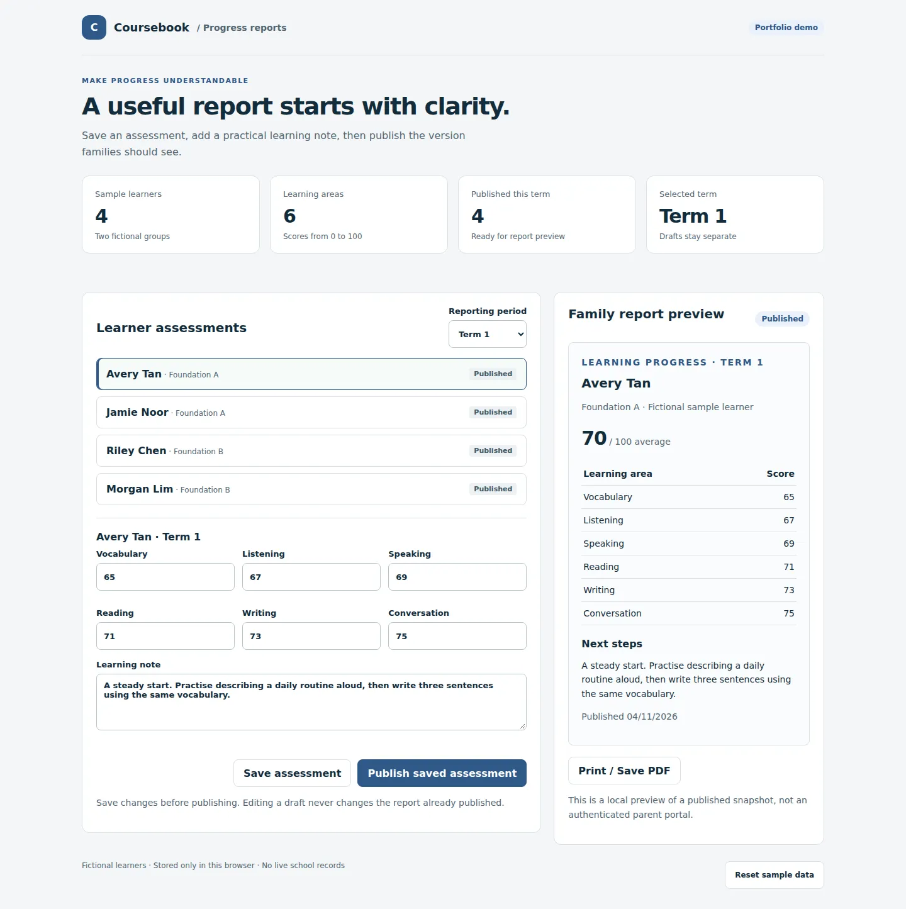

# Coursebook — assessment drafts that stay private until published

A small course reporting workflow: record six learning areas, add a useful next step, and publish a stable report snapshot.

**Portfolio project by Only Sahifli Supit · JavaScript · HTML/CSS · Node.js tests**

All learners, groups and grades are fictional. This is a standalone portfolio demonstration, not a copy of a client application or an authenticated parent portal.



[View the mobile layout](docs/mobile.webp)

## Try the workflow in two minutes

```bash
git clone https://github.com/onlysahiflisupit/course-management-demo.git
cd course-management-demo
npm start
```

Requires Node.js 22 or later. Open **http://127.0.0.1:4173**. If the helpdesk demo is also running, stop it first or use a different `PORT`.

1. Select Avery Tan in Term 1. A sample report is already published.
2. Change Vocabulary to **100** and choose **Save assessment**. The published preview remains unchanged.
3. Choose **Publish saved assessment**. The preview now uses the saved values.
4. Switch to Term 2 to see the not-started state.
5. Use **Print / Save PDF** for a browser print layout of the published report.

## What makes the workflow useful

| Rule | Behavior |
|---|---|
| Grades are whole numbers from 0 to 100 | Blank values, decimals and out-of-range numbers are rejected |
| A saved draft is not a published report | Editing or saving cannot silently change the family-facing snapshot |
| Publishing needs a meaningful note | Notes shorter than 10 characters are blocked |
| Unsaved changes need a decision | Switching learners or terms opens a discard confirmation |
| Terms belong to individual learners | Records use a student ID plus reporting period |
| Families need a readable result | Six scores, an average and a learning note form one printable report |

## Review the implementation

- [Assessment and publishing rules](docs/design.md)
- [Domain tests](tests/domain.test.mjs)
- [Testing scope](TESTPLAN.md) and [limitations](RISK.md)
- [Regression suite](https://github.com/onlysahiflisupit/qa-testing-portfolio)

```bash
npm test
```

Native JavaScript modules keep the domain functions readable and independently testable. This example demonstrates frontend state and publishing semantics; it does not represent a production gradebook or secure access-control system.

## What a production version would need

A backend with permission checks, authenticated parent access, tenant isolation, server-side validation, backups, an audit trail and controlled publication. The current preview is visible to anyone using the same browser. Do not enter real student records.

[About Only](https://github.com/onlysahiflisupit) · [Helpdesk demo](https://github.com/onlysahiflisupit/it-helpdesk-demo)
